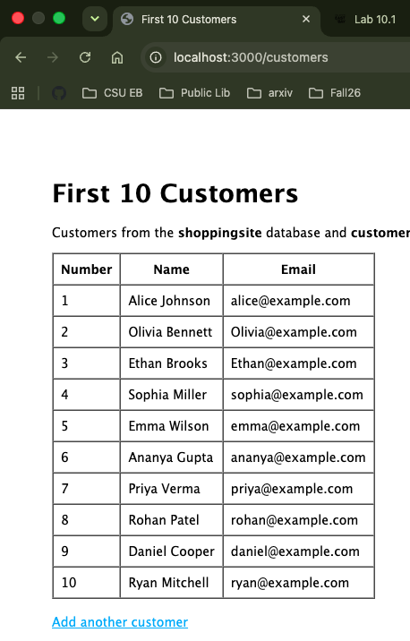
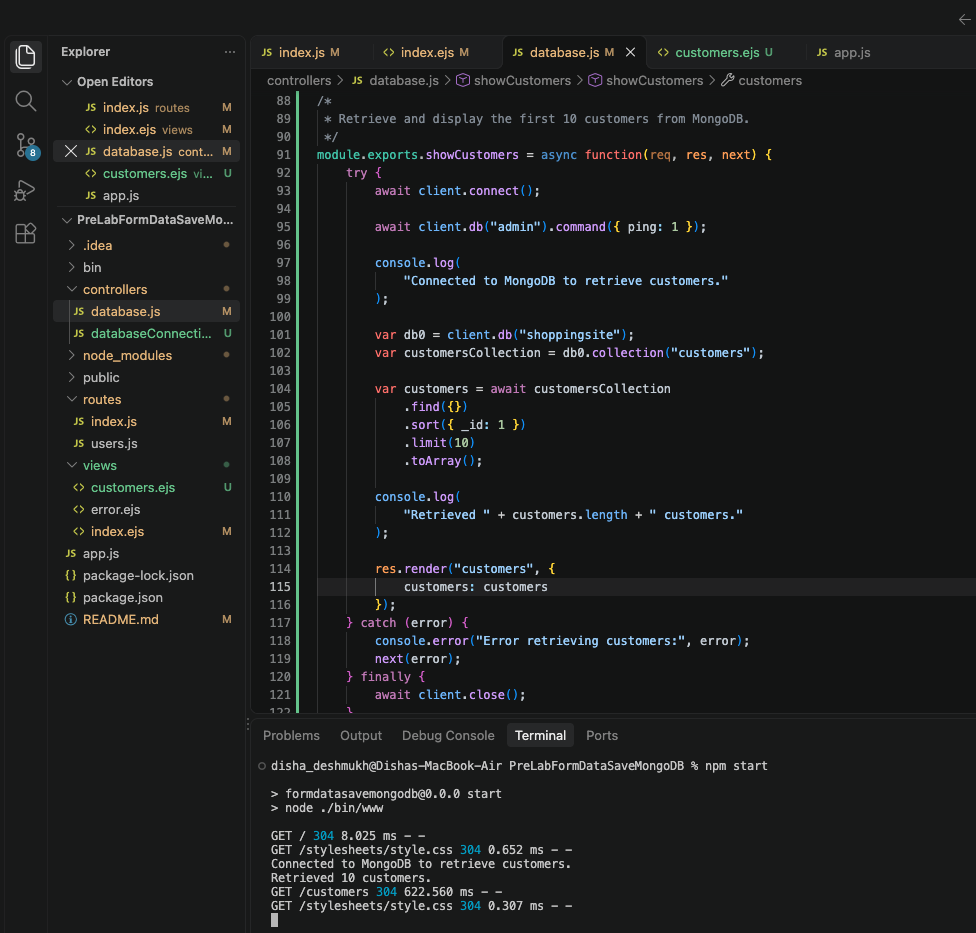
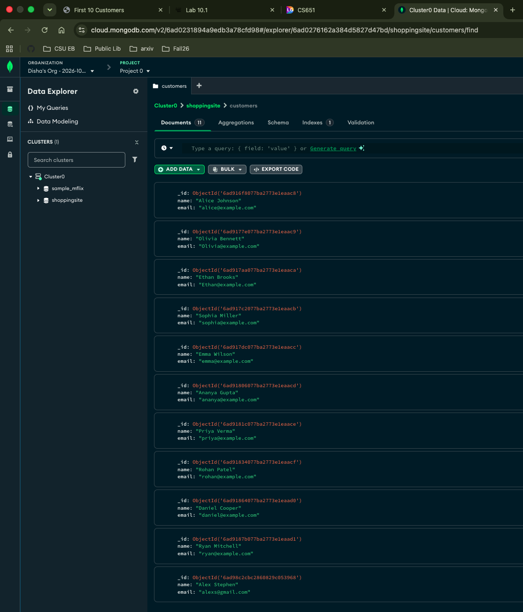

# Lab 10.1: Customer Database Deployment

This project is a Node.js/Express application that stores customer information in a MongoDB Atlas database. It uses the `shoppingsite` database and the `customers` collection.

## Features

- Submit a customer name and email through a web form.
- Save the customer as a document in MongoDB.
- Retrieve and display the first 10 customers from the `customers` collection.

## Requirements

- Node.js and npm
- A MongoDB Atlas cluster

## Setup

1. Install the dependencies:

   ```bash
   npm install
   ```

2. Set your MongoDB Atlas connection string in the shell before starting the app. Keep the value in the local, ignored `mongodb-credentials.local.txt` file if needed:

   ```bash
   export MONGODB_URI='mongodb+srv://<username>:<password>@<cluster-host>/shoppingsite?retryWrites=true&w=majority'
   ```

   Do not commit real database credentials to a public repository.

3. Make sure the Atlas user has permission to read and write to the database, and that your IP address is allowed in the cluster network access settings.

## Run the application

Start the server from the project directory:

```bash
npm start
```

Then open [http://localhost:3000](http://localhost:3000).

- Use the form on the home page to add a customer.
- Open [http://localhost:3000/customers](http://localhost:3000/customers) to display the first 10 customers.

The `/customers` route queries the `shoppingsite.customers` collection, sorts documents by `_id`, and limits the result to 10 documents.

## Lab evidence

The application running and retrieving 10 customers:



Code running in VS Code with the server output showing that 10 customers were retrieved:



MongoDB Atlas showing the `shoppingsite.customers` collection with 11 documents:


